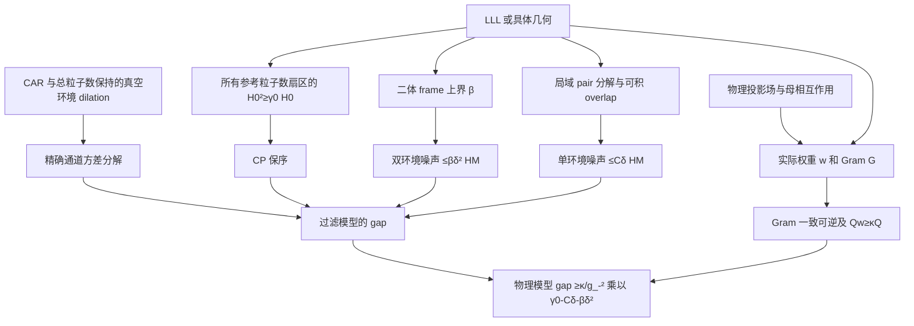

> **AI-assisted research draft — human verification and independent peer review are incomplete.** New proof claims remain provisional. See [HUMAN_REVIEW.md](HUMAN_REVIEW.md).

# 覆盖范围与依赖关系（2026-10-16 审查）

本文件区分本次推导、已核实的外部定理、数值诊断和未闭合路线。没有声称穷尽所有 vortexable 子空间，也没有用 Chern 数或零模替代谱隙证明。

## 依赖图

CAR、CP 和噪声的代数分解不依赖 LLL、SU(2)、平移对称性或标量乘法。可积 overlap 与 frame 上界控制系统尺寸；Gram 控制的是过滤强度。LLL 特别提供两种可显式核验的东西：Gaussian overlap 的 Schur 积分，以及接触 pair 的 center-of-mass coherent frame。标量/rank-one 乘法只在物理场求导消项时出现。

## 哪些模型已经覆盖

| 类别 | 状态 | 具体输入与结论 | 不应额外推断的内容 |
|---|---|---|---|
| 原正标量弱 Gram 形变，完整平面 | 本次解析审查支持，外部谱隙输入已核实 | `gap >= (m/g_-)²(1/5-14δ-δ²)`；不是必须实空间小振幅 | 不等于任意有限 torus 的三重基态 gap |
| 球面光滑正标量形变 | 同上，参考 Q 需充分大 | C=14 对 Q 一致；Q=3(N−1) 时保留唯一零模 | 不提供显式最小 Q，不涵盖任意小球面 |
| 非投影二体 frame，`\|\|Q\|\|<=β` | 抽象定理成立 | 双环境项必须为 βδ²；单环境项需可积 overlap | 只知 β 而无局域 overlap 不足以使用本估计 |
| 非正交 frame、多个接触通道 | 抽象定理成立，联合标签测度处理 | 必须计算包含交叉通道的完整 Schur 行/列界及 β | 不能只分别检查每个通道而遗漏交叉项 |
| 有限 Slater-rank pair kernel | 抽象定理与可操作分解成立 | 加权双重 overlap 和有界分解系数控制 C；有显式分离块家族 | rank 有限但随体积增长时不保证一致常数 |
| **有零线的平面标量形变** | **新增完整实例** | `f=2cos(kx)cos(ky)`，`k²ell²=2π`；Gram 一致可逆、pair coercivity；gap >0.1763 | 零线不等于 Gram 奇异；不主张有光滑无奇点的 Kähler potential |
| 秩一多轨道 `t(r)hLLL` | 物理导数计算成立 | 输入 rank 1、输出 s 轨道；各向同性轨道接触权重 `(t†t)²` | 归一化 orbital texture 是局域等距嵌入，不能包装为一般非平凡多带定理 |
| 一般输入 rank>1 的矩阵 T | 原标量论证失效 | 导数 T 的项可乘 `chi_mu chi_nu !=0`，已有显式反例 | 不能继承 1/3 Laughlin 的填充、kernel、拓扑解释 |
| 全局光滑双射 vortex coordinate，带 Jacobian 的 pullback | 几何推广已推导 | 明确权重 `J\|\|DF\|\|_F²/2`；有正上下界则直接比较 | 任意局部全纯描述不等于存在全局双射 |
| **任意有限振幅的周期保面积 shear** | **新增可计算实例** | 普通物理导数接触，gap >=1/5；整个 kernel 精确 pullback | 属几何构造；不证明所有非标准 vortex coordinates 均有隙 |
| finite torus | 条件性迁移 | 需该 torus 全 Fock 参考 gap、磁边界一致的局域 frame 和尺寸一致 C、β | 平面定理不自动提供这些输入 |
| 所有 C=1 vortexable bands | 未解决，本文不覆盖 | 缺全局表示、正则性、Gram、局域 pair frame 与一致 overlap 条件 | C=1、clustering 和存在零模均不是 gap 充分条件 |

完整公式和假设见 `TRANSFER_THEOREM_REVISED.md`；物理模型、场归一化、非标量限制和坐标 Jacobian 见 `PHYSICAL_EXTENSIONS.md`。文献中几何表示结果的真实假设见 `LITERATURE_AUDIT.md`，不能把本表改写为无条件覆盖全部 ideal bands。

## 有明确反例或必要限制的地方

1. **缺 β 的非投影推广是假的。** 精确有限 Fock 例给出 `N2/(δ² HM)=3`，因此把双环境系数固定为一会失败；见独立检查与 `NUMERICAL_AUDIT.md`。
2. **删除 M 可逆性会破坏原 kernel 的映射。** singular filter 可直接消灭整个 pair interaction，新增零模。含零点的实空间 f 与奇异的投影 Gram 是不同条件。
3. **vortexability 不蕴含此表示的统一 Gram 下界。** `f=exp(-s|r|²/(4ell²))` 给 `G_nn=(1+s)^(-(n+1))->0`，仍是 z-vortexable；这个模型还可以用磁长变化处理，故该反例针对 Gram 推论，不针对 gap。
4. **矩阵导数的自动抵消是假的。** `T=diag(1,exp(ikx))` 给非零 `ik exp(ikx) chi_1 chi_2` 项。
5. **固定数值阈值不是零模计数证书。** 独立实现的近奇异可逆过滤产生小正本征值，`1e-9` 阈值会把它们误计入 kernel；此为诊断失效，不能称为数学零模增加。
6. **缺物理能标时不可能给整个类一个共同正数。** 坐标 dilation 改变导数接触能标为比例的四次方。需要固定磁长/耦合单位并控制几何。

## 未闭合路线的具体缺口

**Torus。** 将 `z` 视为全局周期乘法算符本身就不正确，应使用磁线丛/适当的 quasiperiodic clustering sections。为应用本定理，需验证：每个磁通和边界 twist 的全 Fock 参考不等式；接触 evaluation/jet frame 的统一上界；在明确 aspect-ratio 范围内的 Schur 积分；以及目标填充 kernel 的计数。周期化 Gaussian 的绝对尾界应放在局域核的行积分中，例如把格点平移后的 Gaussian 多项式包络展开到全平面积分；不能先累积全体 pair 的绝对误差再称其为 gap 修正。本次未完成这些 torus 输入，不报 torus gap 数字。

**更大 Gram 形变。** C=14 是严格解析改善，仍是充分条件。大 Gram 偏差未通过它，不代表 gap closing。进一步可对明确的 `R_M^*R_M` 做带权 Schur 或局域有限矩阵上界，并加 Gaussian 尾界。若走 SDP，只优化该相对界及可证明残差修复；没有必要为本轮已有正例启动巨大 `H_f²` SDP。

**连续路径。** 逐步下界需要递推 `gamma_(j+1)>=lambda_j(gamma_j-eta_j)`，还必须为新参考模型建立下一步所用的 frame/noise 常数。只把参数区间切细不能证明任意长度有隙。零线例子可逐参数代入同一个 LLL 参考界，但这本身仍不是有局域生成元的相稳定性定理。

**一般 vortexability 的表示。** 定义 `(1-P)zeta P=0` 在无界坐标的共同稠密定义域上解释，非退化 vortex metric、全局坐标、有限轨道 fiber、周期边界及权重控制须另行检查。现有 holomorphic/curved-space 表示不能省去这些定量条件。本文给了明确的充分覆盖类，不证明最一般边界。

**拓扑相和局域性。** 本文母相互作用在未投影物理场中是导数接触；投影 Hamiltonian 的局域/准局域性质是另一命题。尤其不能从单粒子 G 可逆直接推断 `G^(-1/2)` 的局域核衰减。也没有把整个 kernel 的正谱隙推成 torus 拓扑简并、任意统计或 Laughlin 相的稳定性。若要使用 lattice gap-stability 定理，须单独核验其局域性、局部拓扑序与几何假设。

最有价值的下一步是为 nodal 周期族建立具有明确边界条件的 torus 接触 frame 与局域 overlap 证书，再配合独立 torus 参考谱隙输入。当前最迫切的缺口不是再提高有限 ED 尺寸。
